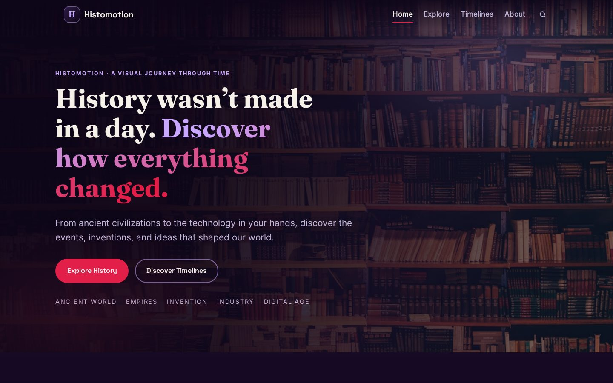
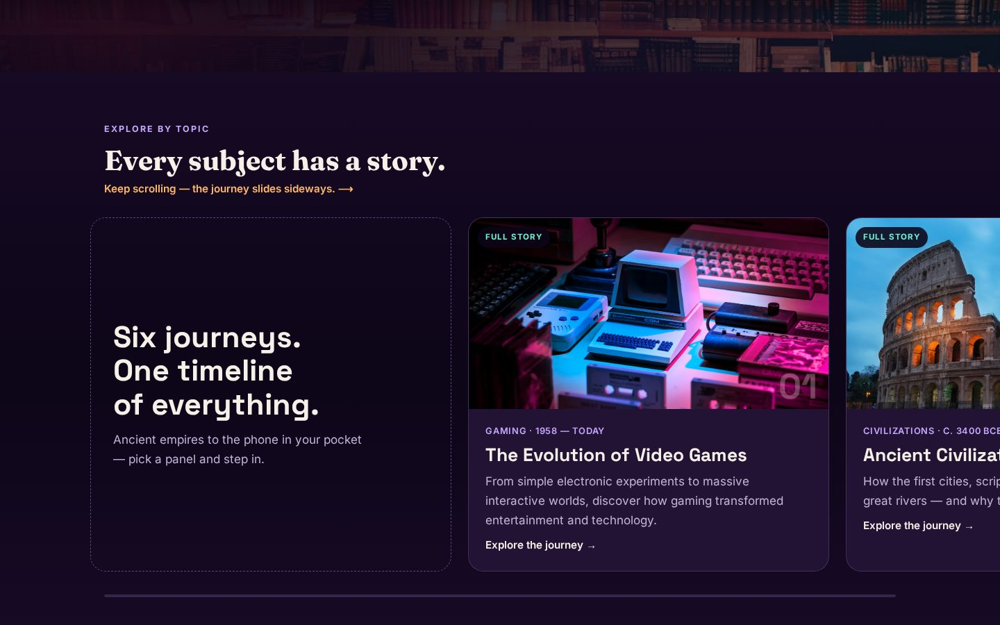
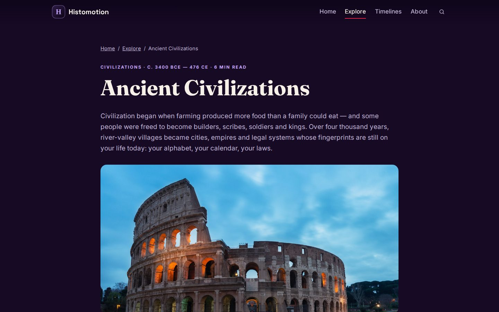

# Histomotion

**Explore the past. Understand the present. Discover how the world evolved.**

A visually immersive, interactive website for exploring history — topics, timelines, inventions and civilizations, told as stories rather than textbook lists.

Built with **React 18 + Vite + GSAP**. Six complete, fact-checked stories (52 milestones), full-text search, a pinned scroll-slide journey, and an accessibility-first design system. No backend.







## Run it

```bash
npm install     # once
npm run dev     # local dev server (Vite prints the URL, usually http://localhost:5173)
npm run build   # production build into dist/
npm run preview # serve the production build locally
npm run verify  # data + search integrity checks (scripts/verify-data.mjs)
```

No backend, database or environment variables. The `dist/` folder from `npm run build` can be dropped onto any static host (Netlify, Vercel, GitHub Pages, Cloudflare Pages).

## What's inside

| Page | Route | What works |
|---|---|---|
| Home | `#/` | Hero (GSAP entrance + parallax), GSAP scroll-slide topic journey (pinned on desktop, swipe row on mobile), featured journey, timeline preview, Why Histomotion, final CTA |
| Explore | `#/explore` | Live full-text search over stories and milestones, category filters, result count, honest empty state with reset |
| Topic story | `#/explore/<slug>` | Breadcrumb, hero, context, chaptered milestone timeline with "why it mattered", takeaways, sources, related topics, prev/next |
| Timelines | `#/timelines` | Search + category filters, milestone previews, links into full stories |
| About | `#/about` | Mission and storytelling approach (no invented founder/company claims) |

Routing is hash-based on purpose: the static build works from any folder with zero server configuration.

## Content — all six stories complete (52 milestones)

All content lives in **`src/data/topics.js`** — components never hardcode topics. Each topic: `slug, title, description, category, period, status, hero, intro, context[], milestones[] (date/title/description/why), takeaways[], sources[], related[]`.

| Story | Milestones | Span |
|---|---|---|
| The Evolution of Video Games | 10 | 1958 — today |
| Ancient Civilizations | 9 | c. 3400 BCE — 476 CE |
| Science Through the Ages | 9 | 1543 — 1953 |
| Inventions That Changed the World | 8 | 105 CE — 1903 |
| History of Transportation | 8 | c. 3500 BCE — 1976 |
| The Evolution of Technology | 8 | 1936 — 2022 |

Every milestone follows the same editorial discipline: a date, what happened, and **why it mattered**. Dates are drawn from established historical records (Wikipedia's topic histories, the Science Museum Group, launch records); contested "first" claims are worded as contested, and each story ends with credited sources. `npm run verify` checks the data file — unique slugs, complete milestones, resolving related links, working search — so content edits can't silently break the site.

To add a topic, copy an entry in `topics.js`, write the milestones, and run `npm run verify`.

## Design system — "Midnight Museum" palette v2

Updated 2026-10-23 to 2026's dark-mode direction (research-grounded): grown-up dark bases instead of saturated purple, warm neutrals, one bold accent used with restraint, neon only as a micro-accent.

| Token | Value | Role |
|---|---|---|
| `--bg` | `#160A24` | deep plum-black base |
| `--bg-deep` | `#0D0518` | near-black violet (footer, gradients) |
| `--surface` / `--surface-2` | `#221334` / `#2E1B45` | cards and raised surfaces |
| `--text` | `#F5F0E8` | warm off-white (Cloud Dancer family) |
| `--text-muted` | `#C2B5D9` | soft lavender-grey |
| `--highlight` | `#C9A7FF` | digital lavender — eyebrows, links, badges |
| `--cta` | `#E11D48` | coral-rose — the one bold accent, CTAs only |
| `--amber` | `#FFB86B` | warm museum amber — dates and timeline markers |
| `--mint` | `#6FF5D2` | aqua micro-accent — focus rings, "full story" signals |

Fraunces (editorial serif) for display headings, Space Grotesk for UI, Inter for body — fluid `clamp()` type. Tokens live at the top of `src/styles/global.css`.

## Motion (GSAP)

GSAP 3 + ScrollTrigger (adopted in v2):

- **Scroll-slide journey** (Home, replaces the old carousel): on screens ≥900px with motion allowed, the topics section pins and vertical scrolling slides the panels left, with a gradient progress bar. On mobile or with `prefers-reduced-motion`, the identical content becomes a native swipeable snap row — no pin, no scroll hijack.
- **Hero**: GSAP entrance stagger + scroll-scrubbed background parallax.
- Everything else stays CSS + IntersectionObserver reveals; all motion is disabled or degraded gracefully under `prefers-reduced-motion`, and GSAP contexts/matchMedia are reverted on unmount.

## Images

Atmospheric photos from Unsplash (Unsplash licence), every URL HTTP-verified before inclusion. They are illustrative, **not** presented as historical photographs (the story template labels them as such). Before a public launch, curate licensed historical imagery per topic.

## Testing

- `npm run build` — production build: JS 312 kB (110 kB gzip, GSAP included), CSS 16.8 kB.
- `npm run verify` — data integrity checks: unique slugs, complete milestones, sources present, all `related` links resolve, filter chips match the data, and search behaviour (full-text queries like "Rome" and "steam") returns the right stories.
- Browser-tested at desktop (1440px) and phone widths (390px / 360px): no horizontal overflow, mobile menu and swipe journey work, filtered lists stay visible, zero console errors.

## Known limitations

- Hash URLs (`#/…`) — chosen for host-independence; switching to clean URLs is isolated to `src/utils/router.js` once a host is picked.
- No CMS, search is client-side over local data (fine at this scale; the data shape is API-ready).
- Images are remote (Unsplash CDN) — self-host when the project is deployed for real.

## Deploy

1. `npm run build`
2. Upload `dist/` to any static host, or connect the repo and set build command `npm run build`, output `dist`.
3. No SPA fallback rules are needed thanks to hash routing.

## Accessibility & engineering notes

- **Skip link** jumps straight to content; every route sets its own `document.title`; WebSite JSON-LD in `index.html`.
- **Contrast**: the CTA rose `#E11D48` was chosen by measurement — white text on it scores 4.7:1 (WCAG AA), hover `#BE123C` 6.3:1.
- **Filter chips are derived from the data** (`FILTER_CATEGORIES` in `topics.js`), so a category chip can never lead to an empty page.
- **Search is full-text** through one shared `filterTopics` (titles, descriptions, context and milestones) used by both Explore and Timelines.
- **Images degrade gracefully**: every content image goes through `SmartImage` (responsive `srcset` + branded gradient fallback), so a failed photo never shows a broken-image glyph.
- **Reveal system**: scroll-in animations use IntersectionObserver plus a MutationObserver, so elements created later — e.g. cards re-rendered by filtering — still animate in instead of staying hidden.

## Roadmap

- Self-host the image library instead of Unsplash hotlinks, with curated historical imagery per topic.
- Clean (history-based) URLs once a host is chosen.
- More stories — the data shape makes adding a topic a content-only change.

## License

MIT — see `LICENSE`. Built by Muhammad Taha (MTBA).
